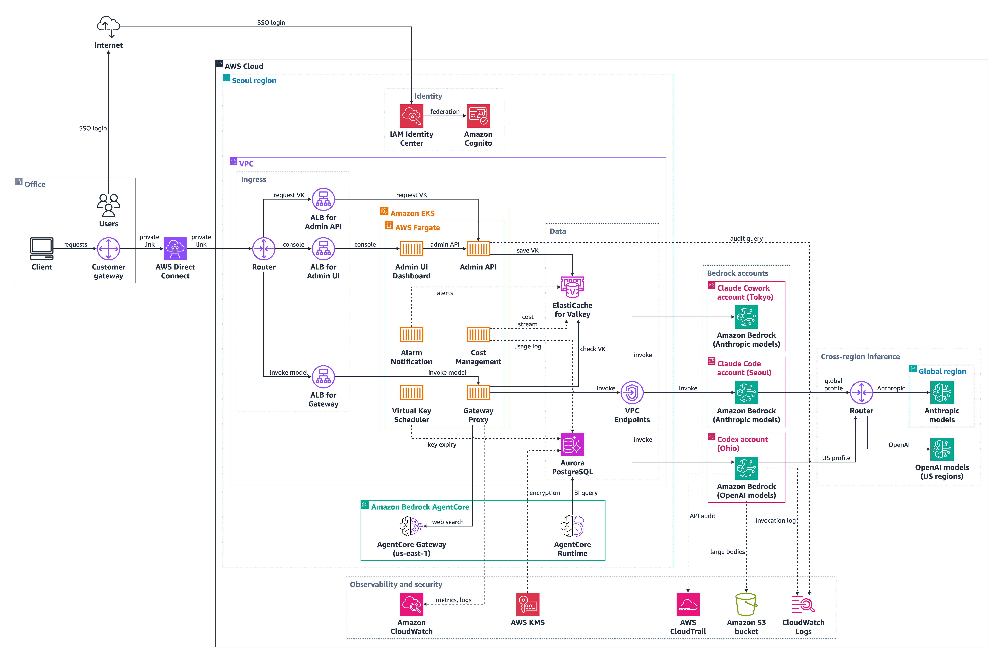

# AWSome AI Gateway 아키텍처 개요

AWSome AI Gateway는 Claude Code, Codex, Claude Cowork 같은 코딩 에이전트와 Amazon Bedrock 사이에 서는 LLM 게이트웨이다. 가상 키(VK) 발급, 예산, 사용량 기록을 한곳에서 처리하고, 앱마다 정해진 AWS 계정의 Bedrock으로 요청을 보낸다. 요청은 왼쪽 사무실에서 AWS Direct Connect로 들어와 Seoul region의 Gateway Proxy를 거쳐 오른쪽 계정들의 Bedrock으로 가며, 요청별 사용량은 Aurora PostgreSQL에, 선택 기능인 model invocation log(프롬프트와 응답 본문)는 CloudWatch Logs와 S3에 남는다.

## 다이어그램 읽는 법
- **그룹**:
  - Office: 직원(Users), 노트북(Client), 사무실 경계 라우터(Customer gateway). AWS Cloud 밖에 있다.
  - Seoul region: 게이트웨이를 배포한 리전. 안에 Identity, VPC, Amazon Bedrock AgentCore 상자가 있다.
  - Identity: 로그인을 맡는 IAM Identity Center와 Amazon Cognito.
  - Ingress: VPC 입구의 Router와 세 ALB(Admin API, Admin UI, Gateway). 트래픽이 pod에 닿기 전에 거치는 것들이다.
  - Amazon EKS 안의 AWS Fargate 상자: 게이트웨이를 이루는 여섯 pod(Admin UI Dashboard, Admin API, Alarm Notification, Cost Management, Virtual Key Scheduler, Gateway Proxy).
  - Data: ElastiCache for Valkey, Aurora PostgreSQL, 그리고 이전 그림의 오른쪽 열을 따라 같은 묶음에 넣은 VPC Endpoints(저장소가 아니라 Bedrock으로 가는 사설 경로).
  - Amazon Bedrock AgentCore 상자: AgentCore Gateway, AgentCore Runtime. 상자는 이전 그림 위치를 지켰고, AgentCore Gateway의 실제 리전(us-east-1)은 노드 라벨에 적었다.
  - Bedrock accounts: 앱별 AWS 계정 세 개. 상자 제목에 각 계정의 리전(Tokyo, Seoul, Ohio)을 적었고, Seoul region 상자 밖에 둔 것도 그 때문이다.
  - Cross-region inference: 교차 리전 추론을 나타내는 Router, Global region 상자 안의 Anthropic models, 그리고 Global region 상자 밖의 OpenAI models (US regions).
  - Observability and security: Amazon CloudWatch, AWS KMS, AWS CloudTrail, Amazon S3 bucket, CloudWatch Logs.
- **선**: 실선은 동기 호출, 점선은 비동기 처리나 보조 관계(선택 기능 포함)다. 선 위의 글자가 그 홉에서 **무엇이 흐르는지**이고, 아래 단계마다 같은 글자를 (라벨 `…`)로 인용했으니 그림에서 그 화살표를 찾으면 된다. 두 선이 만나는 곳의 작은 반원은 서로 이어지지 않고 지나간다는 표시다.
- 사용자와 외부 구간(Office, Internet, AWS Direct Connect)은 AWS Cloud 상자 밖에 있다.

## 단계별 흐름
1. **Users → Internet**: 직원이 콘솔이나 CLI에 로그인할 때 SSO 로그인은 사무실 전용선이 아니라 인터넷을 거친다. Users 위로 곧게 올라가는 선이다. (라벨 `SSO login`)
2. **Internet → IAM Identity Center**: 인터넷을 거친 SSO 요청이 Seoul region의 IAM Identity Center에 도착해 직원(workforce) 신원을 인증한다. 그림 맨 위를 가로지른 뒤 내려오는 선이다. (라벨 `SSO login`)
3. **IAM Identity Center → Amazon Cognito**: IAM Identity Center가 인증한 신원을 Amazon Cognito에 연동한다. 콘솔과 CLI 로그인에 쓰는 OIDC는 Cognito가 맡고, Admin API는 이 로그인을 근거로 가상 키를 발급한다. (라벨 `federation`)
4. **Client → Customer gateway**: 노트북의 Claude Code, Codex, Cowork가 보내는 요청(가상 키 요청, 콘솔, 모델 호출)은 모두 먼저 사무실 경계 라우터인 Customer gateway로 간다. (라벨 `requests`)
5. **Customer gateway → AWS Direct Connect**: 사무실과 AWS 사이는 인터넷이 아니라 AWS Direct Connect 전용 회선으로 이어진다. (라벨 `private link`)
6. **AWS Direct Connect → Router**: 전용 회선이 VPC 입구의 Router에 닿는다. 여기서 트래픽이 목적지별로 세 ALB로 갈라진다. (라벨 `private link`)
7. **Router → ALB for Admin API**: 가상 키 요청은 Admin API 앞의 ALB로 간다. 위로 꺾인 선의 가로 구간에 글자가 있다. (라벨 `request VK`)
8. **Router → ALB for Admin UI**: 관리 콘솔 트래픽은 Admin UI 앞의 ALB로 곧게 간다. (라벨 `console`)
9. **Router → ALB for Gateway**: 모델 호출은 Gateway Proxy 앞의 ALB로 간다. 이 시스템의 주 요청 경로이고, 여기서부터 Gateway Proxy와 VPC Endpoints를 지나 오른쪽 계정들까지 한 줄로 이어진다. (라벨 `invoke model`)
10. **ALB for Admin API → Admin API**: ALB가 가상 키 요청을 Fargate의 Admin API pod로 넘긴다. Admin API는 키, 예산, 모델, 감사 API를 맡는다. (라벨 `request VK`)
11. **ALB for Admin UI → Admin UI Dashboard**: ALB가 콘솔 요청을 Admin UI Dashboard pod로 넘긴다. (라벨 `console`)
12. **Admin UI Dashboard → Admin API**: 콘솔은 키, 예산, 모델 관리를 Admin API 호출로 처리한다. (라벨 `admin API`)
13. **Admin API → ElastiCache for Valkey**: Admin API가 발급한 가상 키를 Valkey에 저장한다. Valkey가 키 캐시 역할을 하므로 Gateway Proxy는 요청마다 여기서 키를 확인한다(15번). (라벨 `save VK`)
14. **ALB for Gateway → Gateway Proxy**: ALB가 모델 호출을 Gateway Proxy pod로 넘긴다. Gateway Proxy는 인증, 한도, 라우팅을 맡는 모델 API다. (라벨 `invoke model`)
15. **Gateway Proxy → ElastiCache for Valkey**: Gateway Proxy가 요청에 담긴 가상 키를 Valkey에서 확인한다. 속도 제한 상태도 Valkey에 있고, 동기 호출이라 확인이 끝나야 모델 호출이 진행된다. Gateway Proxy는 요청별 비용 이벤트도 Valkey 스트림에 남기는데, 이 발행은 따로 선을 긋지 않았다(25번 참고). (라벨 `check VK`)
16. **Gateway Proxy → VPC Endpoints**: 확인을 마친 요청은 VPC Endpoints를 거쳐 Bedrock으로 간다. 인터넷을 거치지 않는 사설 경로다. (라벨 `invoke`)
17. **VPC Endpoints → Amazon Bedrock (Claude Cowork account)**: Cowork 요청은 Claude Cowork 계정(Tokyo, ap-northeast-1)의 Amazon Bedrock으로 간다. 이 계정은 Mantle로 Anthropic 모델을 쓴다. (라벨 `invoke`)
18. **VPC Endpoints → Amazon Bedrock (Claude Code account)**: Claude Code 요청은 Claude Code 계정(Seoul, ap-northeast-2)의 Amazon Bedrock을 native API로 호출한다. (라벨 `invoke`)
19. **VPC Endpoints → Amazon Bedrock (Codex account)**: Codex 요청은 Codex 계정(Ohio, us-east-2)의 Amazon Bedrock으로 간다. 이 계정은 게이트웨이 자신의 계정이고, Mantle과 bedrock-runtime 두 경로로 OpenAI 모델을 쓴다. (라벨 `invoke`)
20. **Amazon Bedrock (Claude Code account) → Router**: Claude Code 계정은 Claude 모델을 `global.anthropic.*` 추론 프로파일로 호출하고, 이 프로파일이 요청을 어느 리전으로든 보낸다. 오른쪽의 Router가 이 교차 리전 라우팅을 나타낸다. (라벨 `global profile`)
21. **Router → Anthropic models**: global 프로파일로 들어온 요청은 Global region의 Anthropic 모델에서 실행된다. (라벨 `Anthropic`)
22. **Router → OpenAI models**: `us.openai.*` 프로파일로 들어온 요청은 US 리전 안에서만 도는 OpenAI 모델로 간다. 그래서 OpenAI models는 Global region 상자 밖에 `OpenAI models (US regions)`로 그렸다. (라벨 `OpenAI`)
23. **Gateway Proxy → AgentCore Gateway**: 웹 검색은 클라이언트가 아니라 게이트웨이가 서버 쪽에서 처리한다(Architecture C). Gateway Proxy가 요청에 web_search 도구를 넣고, 모델이 그 도구를 부르면 AgentCore Gateway의 managed WebSearch를 호출한 뒤 결과를 다시 넣어 준다. 이 AgentCore Gateway는 us-east-1에 있어 Seoul에서 리전을 건너 호출한다. (라벨 `web search`)
24. **AgentCore Runtime → Aurora PostgreSQL**: AgentCore Runtime에서 도는 BI 어시스턴트 에이전트가 운영자의 BI 질문에 답하려고 Aurora를 조회한다. (라벨 `BI query`)
25. **Cost Management → ElastiCache for Valkey**: Cost Management(cost-recorder worker)가 Gateway Proxy가 남긴 비용 스트림을 Valkey에서 읽어 간다. 요청 경로 밖에서 도는 비동기 처리(점선)라서, 기록 작업이 모델 호출을 붙잡지 않는다. (라벨 `cost stream`)
26. **Cost Management → Aurora PostgreSQL**: Cost Management가 요청별 토큰과 비용을 사용량 로그로 Aurora에 쓴다. Aurora에 쌓이는 것은 이 사용량 로그이고, 프롬프트와 응답 본문인 invocation log는 Aurora로 가지 않는다(27, 28번). (라벨 `usage log`)
27. **Amazon Bedrock (Codex account) → CloudWatch Logs**: model invocation logging을 켜면 Bedrock이 프롬프트와 응답 본문을 CloudWatch Logs(`/aws/bedrock/modelinvocations`)에 쓴다. 선택 기능이고 기본값이 꺼짐(지금도 꺼짐)이라 점선이다. IaC 모듈이 설정하는 곳은 게이트웨이 계정인 Codex 계정이고, cross-account로 호출되는 Cowork와 Claude Code 계정은 로깅을 각자 설정한다. (라벨 `invocation log`)
28. **Amazon Bedrock (Codex account) → Amazon S3 bucket**: CloudWatch Logs에 담기에 너무 큰 본문은 S3 버킷으로 간다(large-data delivery). 모든 로그를 S3로 보내는 전체 전달(`s3_config`)은 일부러 꺼 두었다. 27번과 같은 선택 기능이라 점선이다. (라벨 `large bodies`)
29. **Admin API → CloudWatch Logs**: Admin API의 감사 기능이 Logs Insights로 invocation log를 조회한다. 쿼리를 걸고 결과를 나중에 받아 오는 비동기 조회라 점선이고, 로깅이 꺼져 있으면 조회할 로그도 없다. (라벨 `audit query`)
30. **Alarm Notification → ElastiCache for Valkey**: 예산 알림과 보안 알림을 맡는 Alarm Notification이 Valkey를 쓴다. 요청 경로 밖의 보조 관계라 점선이다. (라벨 `alerts`)
31. **Virtual Key Scheduler → Aurora PostgreSQL**: Virtual Key Scheduler가 키 만료와 교체 작업으로 Aurora의 키 정보를 갱신한다. 일정에 따라 도는 보조 작업이라 점선이다. (라벨 `key expiry`)
32. **Gateway Proxy → Amazon CloudWatch**: Gateway Proxy의 메트릭과 애플리케이션 로그가 CloudWatch로 간다. 관측 관계는 대표 선 하나만 그렸다. (라벨 `metrics, logs`)
33. **AWS KMS → Aurora PostgreSQL**: Aurora 암호화에 AWS KMS 키를 쓴다. 대표 보조 선이다. (라벨 `encryption`)
34. **Amazon Bedrock (Codex account) → AWS CloudTrail**: Bedrock API 호출이 CloudTrail에 감사 기록으로 남는다. 본문을 담는 invocation log와 달리 CloudTrail은 누가 어떤 API를 불렀는지를 남긴다. 대표 보조 선이다. (라벨 `API audit`)
35. **Amazon Bedrock (Codex account) → Router**: Codex 계정의 bedrock-runtime 경로는 GPT 모델을 `us.openai.*` 프로파일로 호출하고, 이 프로파일은 요청을 US 리전 안에서 라우팅한다(22번으로 이어짐). Claude Cowork 계정에는 이런 선이 없다. Cowork는 Mantle에서 리전 접두사 없는 모델 ID(`anthropic.claude-opus-4-8`)를 쓰고, Mantle에는 교차 리전 프로파일이 없기 때문이다. (라벨 `US profile`)

## 서비스
| 서비스 | 이 시스템에서의 역할 | 비고 |
|---|---|---|
| Users | 콘솔과 CLI를 쓰는 직원 | Office |
| Client | 노트북의 Claude Code, Codex, Cowork | Office |
| Customer gateway | 사무실 경계 라우터 | Office |
| Internet | SSO 로그인 경로 | AWS Cloud 밖 |
| AWS Direct Connect | 사무실과 AWS를 잇는 전용 회선 | AWS Cloud 밖 |
| IAM Identity Center | 직원 SSO | Seoul region, Identity |
| Amazon Cognito | 콘솔과 CLI 로그인용 OIDC | Seoul region, Identity |
| Router (VPC 입구) | Direct Connect에서 들어온 트래픽을 세 ALB로 나눔 | VPC, Ingress |
| ALB for Admin API | Admin API 진입점 | VPC, Ingress |
| ALB for Admin UI | 콘솔 진입점 | VPC, Ingress |
| ALB for Gateway | 모델 API 진입점 | VPC, Ingress |
| Admin UI Dashboard | 관리 콘솔 | EKS Fargate pod |
| Admin API | 키, 예산, 모델, 감사 API | EKS Fargate pod |
| Alarm Notification | 예산 알림, 보안 알림 | EKS Fargate pod |
| Cost Management | cost-recorder worker, 사용량 로그 기록 | EKS Fargate pod |
| Virtual Key Scheduler | 키 만료와 교체 작업 | EKS Fargate pod |
| Gateway Proxy | 모델 API: 인증, 한도, 라우팅, 서버 쪽 웹 검색 | EKS Fargate pod |
| ElastiCache for Valkey | 키 캐시, 속도 제한, 비용 스트림 | VPC, Data |
| Aurora PostgreSQL | 키, 예산, 사용량 로그 | VPC, Data. invocation log는 여기 없음 |
| VPC Endpoints | Bedrock으로 가는 사설 경로 | VPC, Data 열 |
| AgentCore Runtime | BI 어시스턴트 에이전트 | Amazon Bedrock AgentCore 상자, Seoul region |
| AgentCore Gateway | 서버 쪽 웹 검색 도구(managed WebSearch) | Amazon Bedrock AgentCore 상자. 실제 리전은 us-east-1 |
| Amazon Bedrock (Claude Cowork account) | Anthropic 모델, Mantle | Claude Cowork account (Tokyo, ap-northeast-1) |
| Amazon Bedrock (Claude Code account) | Anthropic 모델, native API | Claude Code account (Seoul, ap-northeast-2) |
| Amazon Bedrock (Codex account) | OpenAI 모델, Mantle과 bedrock-runtime | Codex account (Ohio, us-east-2), 게이트웨이 계정 |
| Router (Cross-region inference) | 교차 리전 추론 라우팅 | AWS Cloud, Cross-region inference |
| Anthropic models | `global.anthropic.*` global 추론 프로파일 | Global region |
| OpenAI models | `us.openai.*` US 교차 리전 프로파일 | Global region 상자 밖, 라벨 `OpenAI models (US regions)` |
| CloudWatch Logs | model invocation log(선택 기능) | Observability and security |
| Amazon S3 bucket | 큰 invocation 본문 | Observability and security |
| Amazon CloudWatch | 메트릭, 애플리케이션 로그 | Observability and security |
| AWS CloudTrail | API 감사 기록 | Observability and security |
| AWS KMS | 암호화 키 | Observability and security |

## 설계 결정
- invocation log 수정: 이전 README 그림은 "Invocation log"를 Aurora PostgreSQL에 붙여 놓았다. 실제(IaC `deployment/terraform/modules/bedrock-invocation-logging`)는 다르다. Bedrock model invocation log는 선택 기능(`enable_bedrock_invocation_logging = false`가 기본값)이고, 켜면 CloudWatch Logs로 가며 큰 본문만 S3로 간다. 그래서 Aurora로 가는 선은 `usage log`, `BI query`, `key expiry`, `encryption`뿐이고, invocation log는 Codex 계정(IaC 모듈이 적용되는 게이트웨이 계정)에서 CloudWatch Logs와 S3로 가는 점선으로 그렸다. cross-account 트래픽을 받는 계정은 로깅을 각자 설정한다.
- 교차 리전 라우팅(코드로 확인): 이전 그림은 세 계정 모두 Router로 이어 놓았지만 실제로는 둘뿐이다. Claude Code는 `global.anthropic.*` 프로파일(20번), Codex의 bedrock-runtime 별칭은 `us.openai.*` 프로파일(35번, `US profile`)을 부른다. Cowork는 Mantle에서 리전 접두사 없는 모델 ID(`anthropic.claude-opus-4-8`, ap-northeast-1)를 쓰고 Mantle에는 교차 리전 프로파일이 없어 Router 선이 없다. 같은 이유로 OpenAI models는 Global region 상자 밖에 `OpenAI models (US regions)`로 두었다.
- 웹 검색: 이전 그림은 계정들에서 AgentCore Gateway로 선을 그었지만, 실제로 AgentCore Gateway를 부르는 것은 게이트웨이 자신이다(서버 쪽 웹 검색, Architecture C). 그래서 23번은 Gateway Proxy에서 AgentCore Gateway로 간다. managed WebSearch 커넥터는 us-east-1에서만 돌아(`agentcore_region`) 노드 라벨에 리전을 적었다.
- AgentCore Gateway 위치: 이전 그림의 Amazon Bedrock AgentCore 상자(Runtime과 Gateway를 함께 담은 상자)를 Seoul region 안에 그대로 두었다. AgentCore Runtime은 Seoul의 메인 배포에 있지만 AgentCore Gateway는 us-east-1에 있으므로, 이 노드만은 상자 위치가 아니라 라벨 `(us-east-1)`이 실제 리전이다.
- 계정 상자: 세 계정 상자를 Seoul region 상자 밖에 두고 제목에 리전(Tokyo, Seoul, Ohio)을 적었다. 서로 다른 리전에 있는 별도 계정이라는 점을 이전 그림은 보여 주지 않았다.
- README 가독성: GitHub는 이 그림을 약 960 px 폭으로 보여 준다. 그 폭에서도 노드 라벨과 그룹 제목이 약 7 px, 선 글자가 약 6 px 이상으로 보이도록 글자 크기를 스킬 기본값(15/14 px)보다 키웠다(노드 라벨과 제목 25 px 굵게, 선 글자 21 px). README 표시를 위한 의도적인 편차다(이전 그림은 약 8 px).
- EKS pod에 맞는 AWS 스텐실이 없어 pod는 `container_1` 아이콘에 서비스 이름을 붙였다.
- 모델은 `bedrock` 아이콘으로 그렸다(SageMaker 아이콘으로 Bedrock을 대신하지 않는다). 계정 상자마다 Bedrock 노드 하나에 모델 계열을 라벨로 붙이고 모델 아이콘을 따로 두지 않았다.
- S3는 리소스 수준의 `bucket` 아이콘으로 그렸다.
- 이전 그림은 IAM Identity Center를 위 줄과 아래 줄에 두 번 그렸는데, 한 번만 그렸다.
- 이전 그림의 KMS, CloudTrail, CloudWatch는 선이 없었다. 각각 대표 보조 선을 하나씩 주었다(32, 33, 34번). 다른 서비스의 로그와 메트릭 선은 그리지 않았다.
- 아이콘 대체: draw.io에는 AgentCore Runtime과 AgentCore Gateway 스텐실이 없어, 스킬에 들어 있는 AWS 공식 아이콘 SVG로 그렸다.
- 배치 편차: 검증기가 AWS Cloud 안의 아이콘은 역할 그룹 안에 있어야 한다고 요구해서 Identity, Ingress, Data, Bedrock accounts, Cross-region inference 묶음을 더했다. 수정 후 Aurora로 가는 선이 모두 아래와 왼쪽에서 들어오므로 ElastiCache for Valkey를 위에, Aurora PostgreSQL을 아래에 두었다. VPC Endpoints는 usage log와 check VK 선 위에 놓이지 않도록 별도 열로 옮겼다.
- 아키텍처 검토(Phase 2)는 AWS 문서 MCP 서버가 연결되지 않아 건너뛰었다. 그래서 출처를 대고 수용한 검토 항목은 없다.

## 이 다이어그램에 없는 것
- VPC 안의 서브넷, 가용 영역, 보안 그룹 같은 네트워크 세부.
- IAM 역할: pod의 IRSA 역할과 cross-account 호출에 쓰는 STS AssumeRole 역할(README의 계정 표 참고).
- 컨테이너 이미지 저장소(ECR)와 배포 구성(Terraform 같은 IaC).
- BI 어시스턴트의 내부 구성(하위 에이전트, Aurora 조회용 query_db Lambda, Code Interpreter). README의 data-plane 설명에 있다.
- Gateway Proxy가 비용 스트림을 Valkey에 발행하는 선(15번과 같은 쌍이라 따로 긋지 않았고, 25번에서 설명했다)과, Cowork와 Claude Code 계정 쪽의 invocation logging 설정.
